<p align="center"></p>

<h1 align="center">CivicHub</h1>

<p align="center"><strong>Making everyday municipal services easier to access.</strong></p>
<p align="center">One digital hub for residents, municipal staff and field guards—so getting things done takes fewer steps than the traditional way.</p>

<p align="center">
  <a href="https://react.dev"></a>
  <a href="https://www.typescriptlang.org"></a>
  <a href="https://vite.dev"></a>
  <a href="https://expressjs.com"></a>
  <a href="https://www.mongodb.com"></a>
  <a href="https://novu.co"></a>
</p>

CivicHub is a municipal services app themed around Tel Aviv-Yafo. Residents can register, pay bills, report problems and appeal fines online. Staff can review disputes, manage billing and dispatch maintenance, while field guards issue parking citations. This repository contains the React front end; its Express and MongoDB API is maintained separately in the [CivicHub backend repository](https://github.com/MohamadAmer1/NewTech_Final-Project_BackEnd).

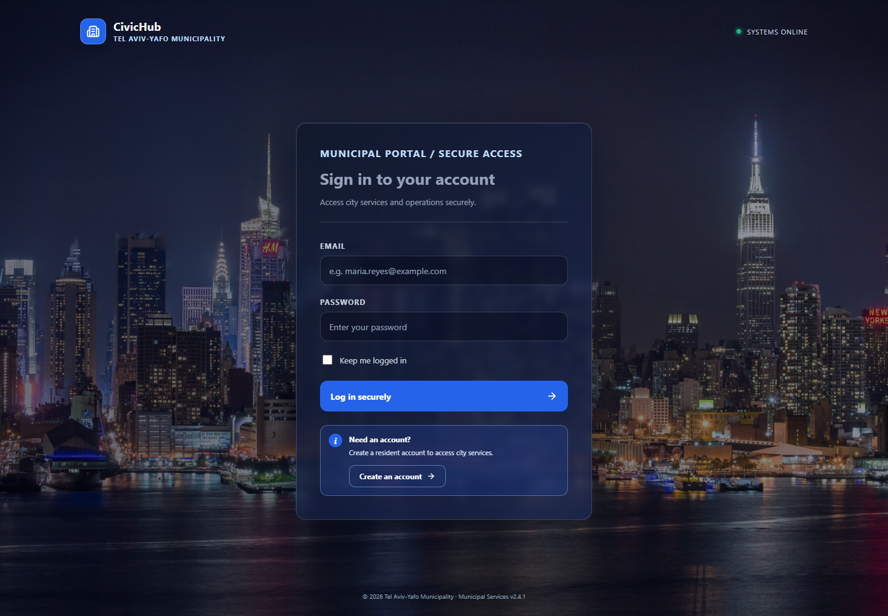

## Portals and features

### Authentication
- Resident self-registration with a password strength meter and live confirm-password check
- Secure login with a "keep me logged in" option (JWT in an HTTP-only cookie)
- Role-based routing and protected pages for `RESIDENT`, `STAFF` and `FIELD_GUARD`

### Resident portal
- Dashboard with account status, balance due, active fines, open requests and a water and electricity usage chart
- Billing: monthly records, PDF receipts and a payment checkout (the checkout is a demo and does not charge anything)
- My services: report a problem with a photo and track its status, view fines and citations, and file appeals with photo evidence
- Properties overview

### Staff portal
- Citation disputes: search, status filters with counts, pending-first sorting, and two-click Accept or Reject
- Billing ledger across all resident accounts and fines
- Resident requests inbox: review, assign to a field guard or reject with a reason
- Maintenance dispatch board: Dispatched, In Progress, Completed and Rejected columns
- Live overview stats and notification bell

### Field Guard portal
- Overview of issued and unpaid fines and assigned reports
- Issue parking citations: license plate lookup finds the vehicle owner, and the fine amount comes from the violation type
- Reports filtered by status and priority
- Issue history

### Everywhere
- Light and dark theme
- Notifications (Novu)
- Toast feedback for actions
- Shekel (₪) amounts and Israeli date formats
- Responsive layout with a slide-in navigation drawer on mobile

## Screenshots

### Sign in and register

| Login | Register |
| :---: | :---: |
|  | 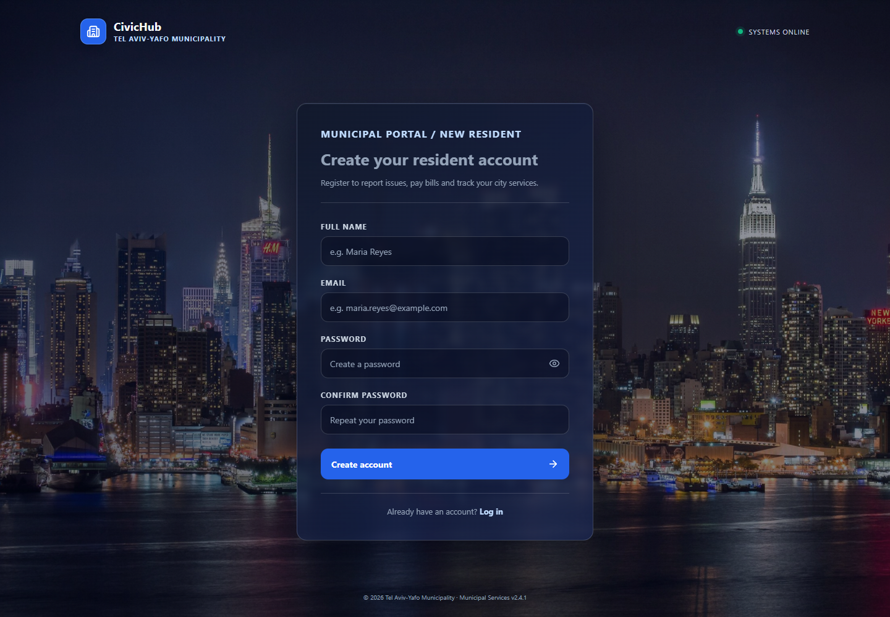 |

### Resident

| Dashboard | Billing |
| :---: | :---: |
| 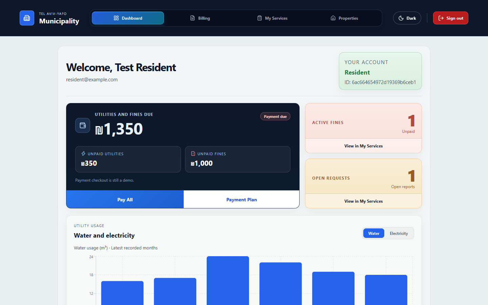 | 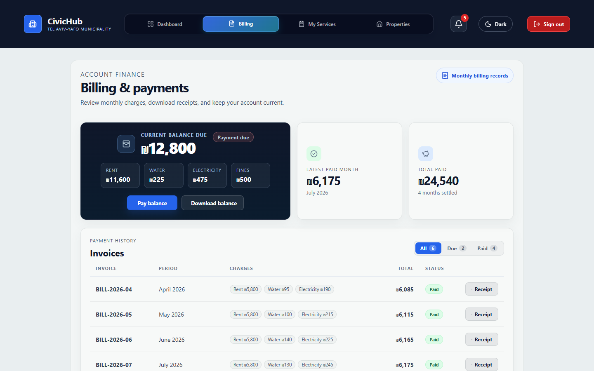 |

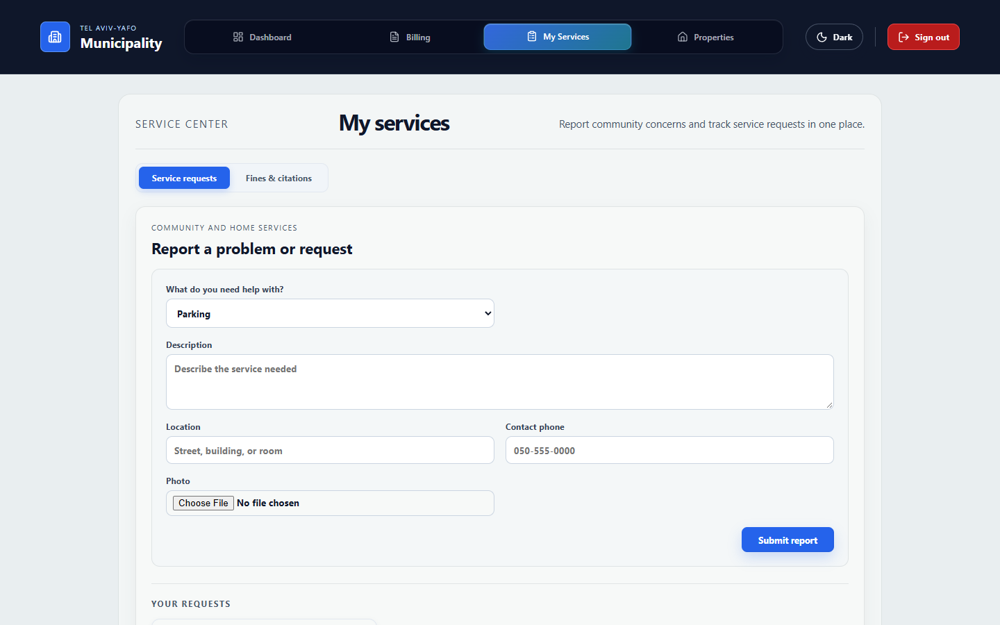

### Staff

| Citation disputes | Billing ledger |
| :---: | :---: |
| 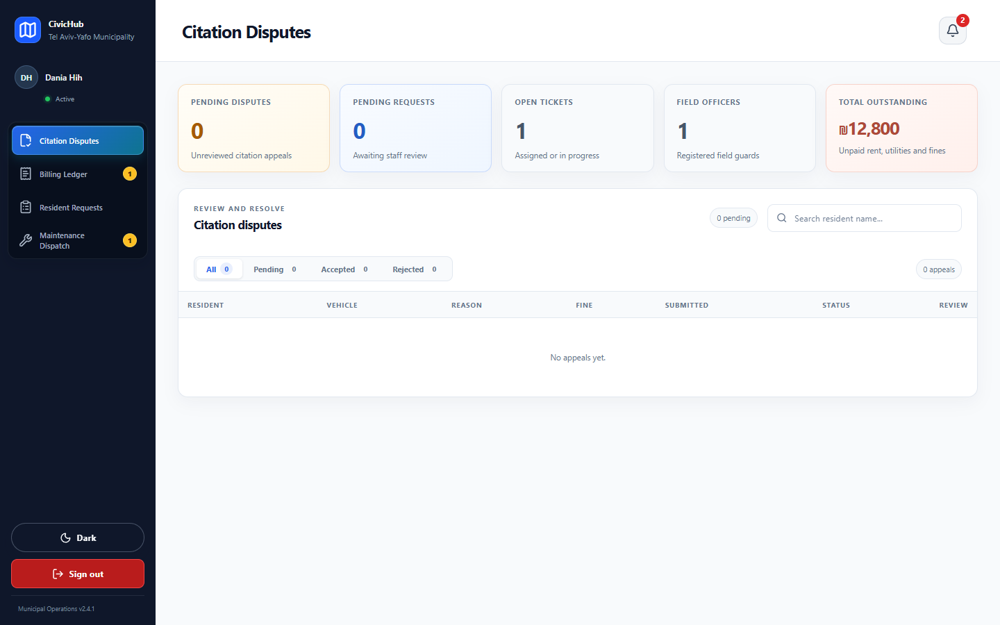 | 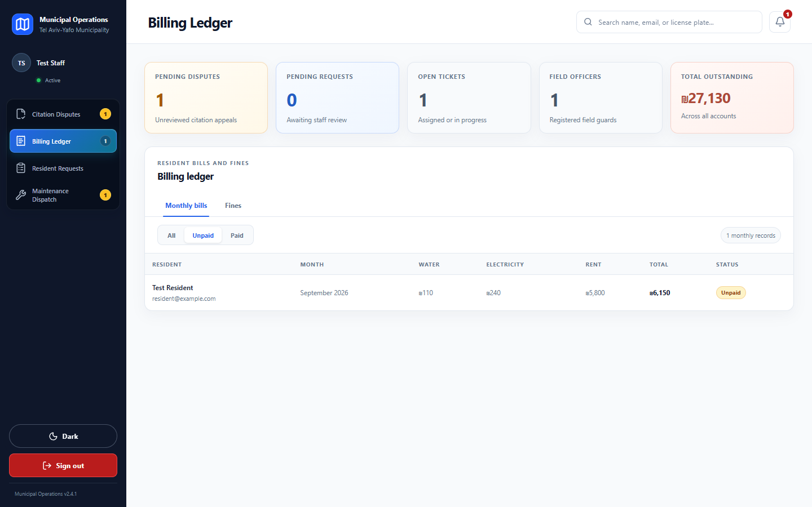 |

| Resident requests | Maintenance dispatch |
| :---: | :---: |
| 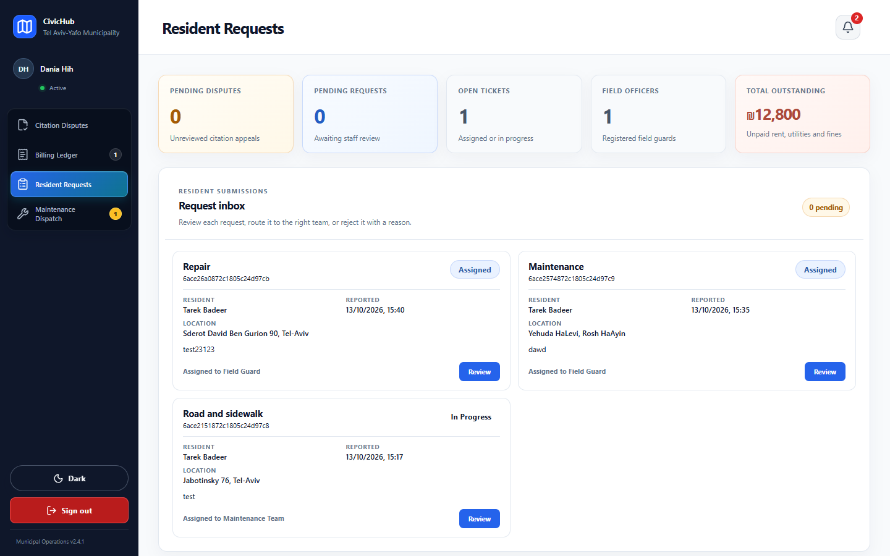 | 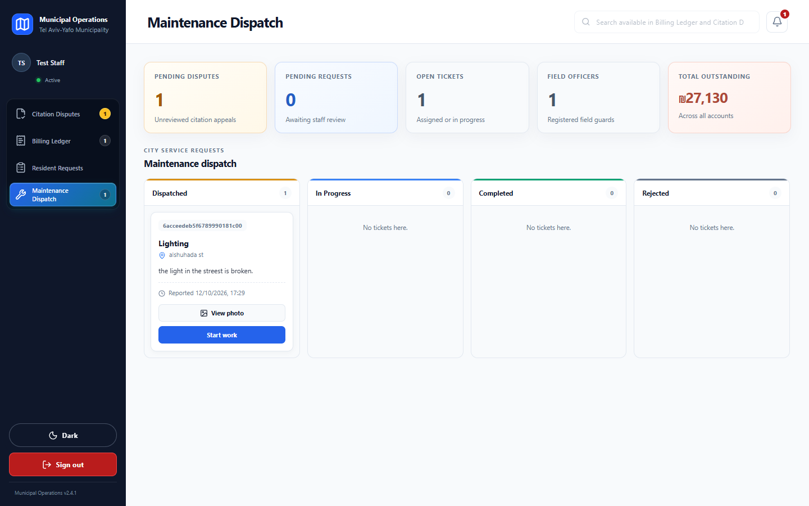 |

### Field Guard

| Overview | Issue citation |
| :---: | :---: |
| 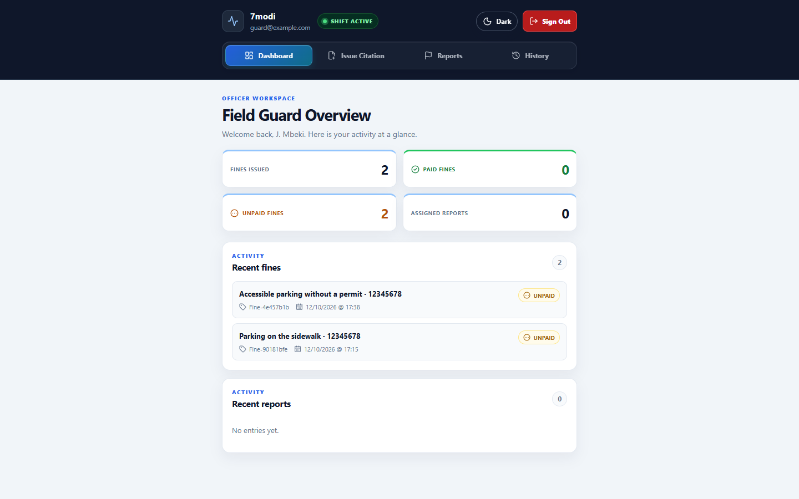 | 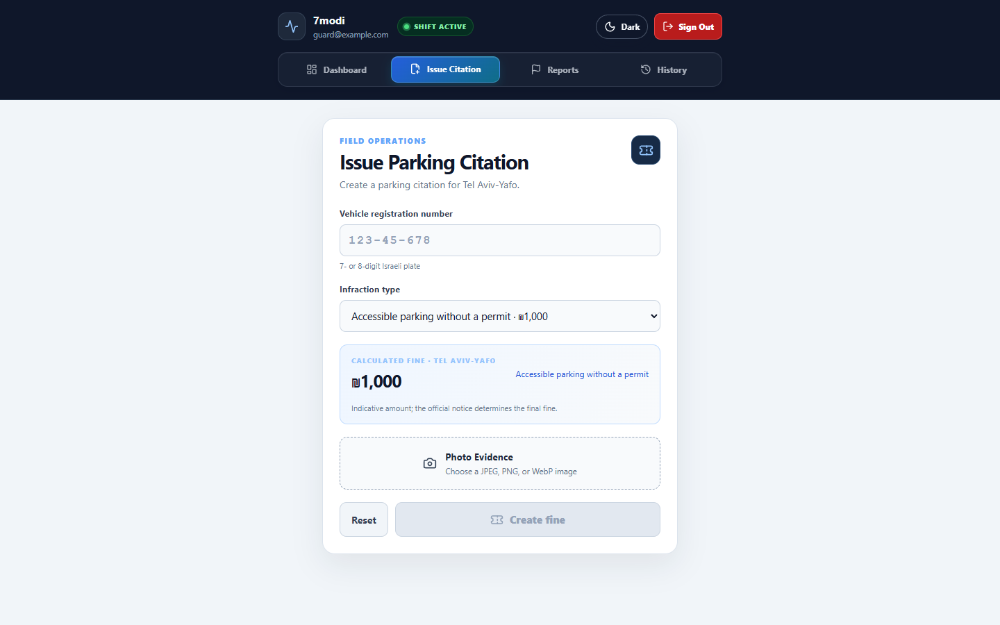 |

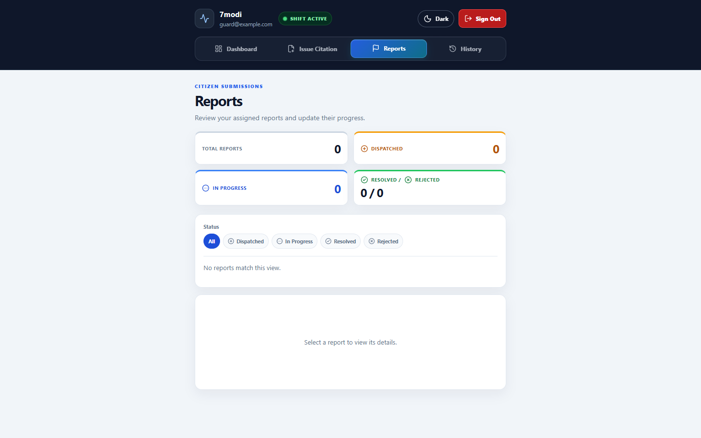

### Mobile

| Resident dashboard | Billing | Staff navigation drawer | Field Guard |
| :---: | :---: | :---: | :---: |
| 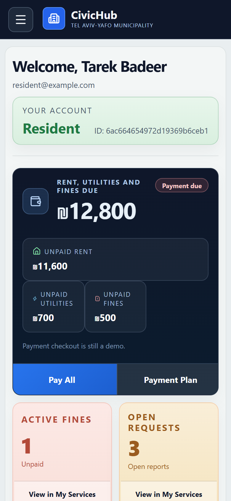 | 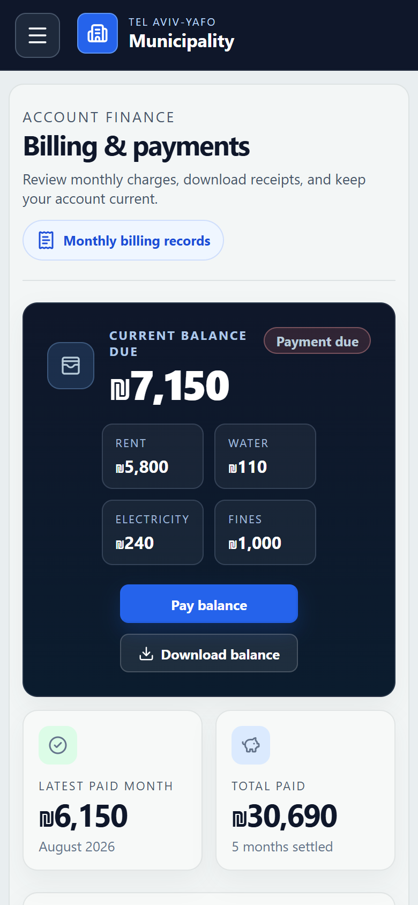 | 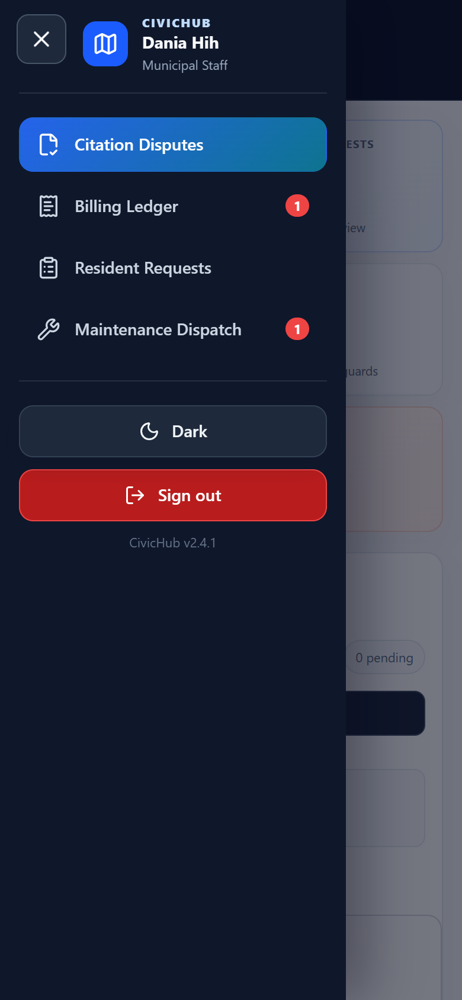 | 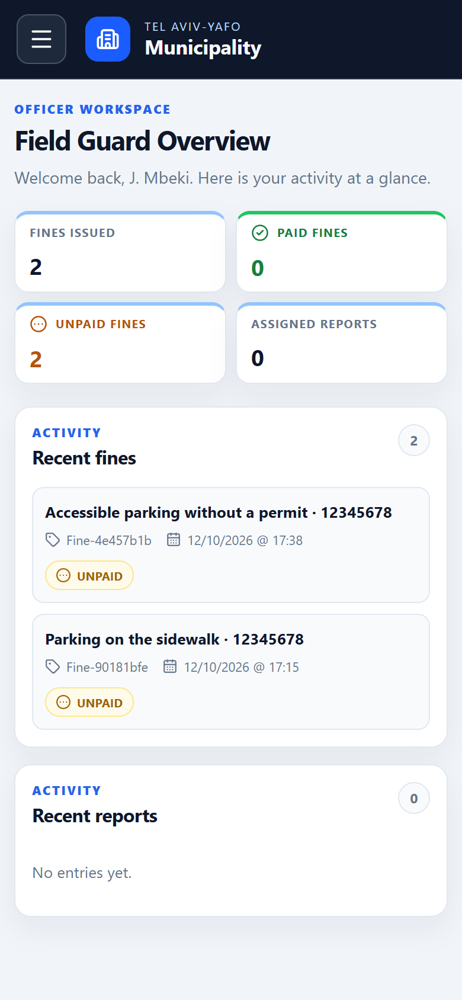 |

## Tech stack

**Front end**
- [React 19](https://react.dev) + [TypeScript](https://www.typescriptlang.org)
- [Vite](https://vite.dev) and [React Router 7](https://reactrouter.com)
- [Leaflet](https://leafletjs.com) for interactive maps and report locations
- [Recharts](https://recharts.org) for charts
- [lucide-react](https://lucide.dev) for icons
- [Sonner](https://sonner.emilkowal.ski) for toasts
- [jsPDF](https://github.com/parallax/jsPDF) + autotable for PDF receipts
- [Novu React](https://docs.novu.co/platform/inbox/react) (`@novu/react`) for in-app notifications
- ESLint for linting

**Back end** (see the [backend repository](https://github.com/MohamadAmer1/NewTech_Final-Project_BackEnd))
- Node.js, Express 5, MongoDB and Mongoose
- JWT authentication with bcrypt-hashed passwords
- Multer and Cloudinary for photo uploads
- `cookie-parser` and `cors` for cookie and cross-origin request handling; `dotenv` for environment configuration
- `@novu/api` and `@novu/framework` for notifications and workflows
- `swagger-ui-express` for API documentation
- `@types/express` for Express development-time types

## Getting started

Requires Node.js 20+. The API is maintained in a [separate repository](https://github.com/MohamadAmer1/NewTech_Final-Project_BackEnd), and requires a MongoDB database that supports transactions (for example MongoDB Atlas).

### 1. Start the API

Clone the [backend repository](https://github.com/MohamadAmer1/NewTech_Final-Project_BackEnd) separately, install its dependencies, and configure it using that repository's README. For local development, the front end sends API requests to `http://localhost:4000` by default. Set `VITE_API_URL` in a root `.env.local` file to override the API origin.

### 2. Start the front end

From this repository's root:

```bash
npm install
npm run dev
```

Open http://localhost:5173. The API allows the origins `localhost:5173`, `5174` and `5175`, so keep Vite on one of those ports.

| Script | Purpose |
| --- | --- |
| `npm run dev` | Start the dev server |
| `npm run build` | Type-check and build for production |
| `npm run preview` | Preview the production build |
| `npm run lint` | Run ESLint |

## Deploying the front end to Netlify

The repository includes a `netlify.toml` with the Vite build command, `dist` publish directory, an API proxy, and a single-page-app fallback for React Router routes. Connect this repository to Netlify from its root directory.

Production builds send API requests to `/api` on the frontend's own origin. Netlify forwards these requests to the separately hosted Express API at `https://backend-civichub.onrender.com`, preserving the route, request body, and session cookies. This avoids browser CORS restrictions and third-party cookie blocking between the frontend and Render. The API proxy must remain before the single-page-app fallback so API requests do not return the frontend HTML.

No API environment variable is required for Netlify deployments. To change the production backend, update the proxy destination in `netlify.toml` and redeploy. For local Vite development only, you can set:

| Variable | Value |
| --- | --- |
| `VITE_API_URL` | The API origin, such as `http://localhost:4000` (the default; no trailing slash or route path) |

For local development, configure the API's credentialed CORS allowlist to include your local Vite origin. Keep the API's HTTP-only session cookie host-only (do not set a Render-specific cookie domain) with `Path=/` so it works through the proxy. Keep backend secrets only in the backend host's environment; do not put them in Netlify's `VITE_` variables.

### Troubleshooting slow login

The login and registration pages remain available while the app checks an existing session in the background. Session checks stop after 15 seconds; protected pages wait for that check before deciding whether to redirect to login. Login requests stop after 20 seconds and show a progress explanation after five seconds, with separate messages for incorrect credentials, rate limits, unavailable servers, and unexpected responses.

If `/api/auth/me` or `/api/auth/login` returns a gateway timeout, the separately hosted API has not responded in time. Check the backend service status and logs in Render, including startup and database connectivity. Client-side timeouts prevent an endless spinner but cannot repair an unavailable backend. Do not repeatedly submit credentials or treat a server timeout as an incorrect password.

### Accounts

- **Resident:** register from the login page ("Create an account").
- **Staff and Field Guard:** new accounts are always created as `RESIDENT`. Change the `role` field of the user in MongoDB to `STAFF` or `FIELD_GUARD`.

### Optional configuration

To enable the notification bell, set `VITE_NOVU_APPLICATION_IDENTIFIER` in a `.env` file at the repository root.

## Project structure

```
src/
├── assets/         Backgrounds and README screenshots
├── components/     Resident, Staff, Field Guard, Login and shared components
├── contexts/       Theme, user and citation state
├── data/           Types and shared data
├── helpers/        Formatting, PDF and field guard helpers
├── layouts/        Staff and Field Guard layouts
├── pages/          Route-level pages (login, register, resident, staff, field guard)
└── styles/         CSS, including the shared mobile system
```

## Team

Helayel Hamayel and Mohamad Amer.